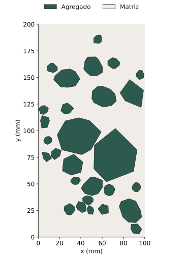
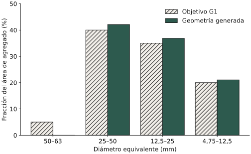

# Delaunay Mesher: de los agregados a una geometría verificable

Un material compuesto contiene inclusiones con tamaños y formas distintos dentro
de una matriz continua. Antes de estudiar su respuesta mecánica hay que representar
esas inclusiones sin solapes, conservar la cantidad de material y describir las
interfaces. **Delaunay Mesher** desarrolla esa preparación geométrica en dos y tres
dimensiones, con semillas reproducibles y comprobaciones de los archivos exportados.

[Repositorio y guía de ejecución](https://github.com/MC-Andes/Delaunay_mesher){ .md-button .md-button--primary }
[Datos del ejemplo](../assets/delaunay/procedencia.json){ .md-button }

**Estado:** desarrollo y verificación geométrica. Proyecto alojado en **MC-Andes,
Universidad de los Andes**. La asignación pública de responsables individuales y
colaboradores está pendiente de confirmación por el equipo.

!!! info "Qué acredita esta página"
    El ejemplo corresponde a la revisión pública
    [`04d3d36`](https://github.com/MC-Andes/Delaunay_mesher/tree/04d3d362677397aeb290d77cb2a9d02959fd44c8).
    Sus controles verifican geometría y archivos; no constituyen validación
    experimental ni una simulación estructural VEM–FEM. La campaña de investigación
    PI192-v3 utiliza un contrato posterior y no se reproduce con este ejemplo.

## Por qué importa representar cada inclusión

En un compuesto, la rigidez de la matriz y la de los agregados pueden diferir.
Su distribución e interfaces forman parte del dominio sobre el que un solver
calcularía desplazamientos y tensiones. Una geometría con partículas superpuestas,
material perdido o unidades ambiguas compromete ese cálculo antes de resolverlo.

El generador trabaja con **polígonos y poliedros convexos**, dentro de un rectángulo
o un prisma. Una granulometría especifica intervalos de tamaño y la proporción de
agregado asignada a cada intervalo. La fracción total de agregado es otra variable:
se refiere a todo el dominio, no solo a las inclusiones.

El ejemplo siguiente permite observar esa diferencia. Es una realización numérica
estática de `CA1_A2_G1_R01`, con dominio de **100 × 200 mm**. El fondo representa
la matriz y los contornos delimitan las 28 inclusiones generadas.

<figure markdown>
{ width="500" loading="lazy" }
<figcaption>Figura 1. Geometría numérica reconstruida directamente de los TXT del ejemplo público. Los ejes están en mm; se muestran interfaces físicas, no una malla de triángulos ni campos de tensión. Fuente: ejecución reproducible del proyecto, semilla 7259952857075019525.</figcaption>
</figure>

La imagen permite inspeccionar posiciones y formas. La ausencia de solapes y la
conservación de área se comprueban además numéricamente: una inspección visual,
por sí sola, no demuestra esas propiedades.

## De una distribución de tamaños a medidas reales

El tamaño se expresa mediante el **diámetro equivalente**: el diámetro del círculo
o de la esfera que tiene la misma área o volumen que la inclusión. Para un área
poligonal *A* y un volumen poliédrico *V*:

- En 2D: **dₑ = √(4A/π)**.
- En 3D: **dₑ = ∛(6V/π)**.
- La fracción de agregado es **φ = Σ Aᵢ / AΩ** o **φ = Σ Vᵢ / VΩ**.

Esto no convierte las partículas en círculos o esferas: relaciona sus medidas con
los intervalos granulométricos. El área se obtiene del contorno orientado y el
volumen de las caras orientadas. Las variables geométricas incluyen posiciones,
orientación, número de lados o caras y relación de aspecto *L/D*.

En el ejemplo público las partículas alargadas están desactivadas y se solicita
*L/D* entre 1 y 1,35. Los parámetros son decisiones del modelo, no propiedades
medidas de una probeta. La configuración asigna **E = 35 000 MPa, ν = 0,16** a la
matriz y **E = 162 000 MPa, ν = 0,17** al agregado; *E* es el módulo de Young y *ν*
el coeficiente de Poisson. No se ha identificado una calibración experimental
que justifique esos valores para un material concreto.

La versión pública describe condiciones nodales provisionales de valor cero.
No define aquí un ensayo mecánico ni una historia de carga. El proceso de
empaquetamiento es una construcción geométrica: sus iteraciones no representan
tiempo físico. Las condiciones iniciales, cargas, apoyos y ley constitutiva del
problema estructural deben fijarse y verificarse en el solver posterior.

## Cómo se construye y comprueba el dominio

El flujo externo desarrollado en el proyecto combina estas operaciones:

1. **Configurar y muestrear:** leer dominio, materiales, granulometría y semilla;
   asignar medidas a un número discreto de inclusiones.
2. **Construir y colocar:** generar formas convexas y buscar posiciones admisibles.
   El teorema del eje separador (SAT) comprueba si existe una dirección que separa
   dos cuerpos convexos; el proyecto lo utiliza para detectar contactos y solapes.
3. **Representar la matriz y las interfaces:** conservar explícitamente las fases
   y su conectividad. El formato público histórico usa una matriz con cavidades.
4. **Auditar y exportar:** comprobar contención, medidas, referencias topológicas y
   lectura posterior; conservar configuración resuelta, semilla y diagnósticos.

La familia `neper_delaunay.py` incorpora también contenedores de Laguerre con
Neper y geometría/mallado con Gmsh. Es una ruta distinta del ejemplo externo 2D:
no es necesario ejecutar Neper para reproducir las figuras de esta página.

| Componente | Función y procedencia |
| --- | --- |
| Python y NumPy | Orquestación, geometría y cálculo; código del proyecto sobre una biblioteca externa |
| `external_postprocess/` | Muestreo, formas, colocación, topología, exportación y comprobaciones del proyecto |
| Neper | Herramienta externa de teselación y generación de policristales usada por rutas específicas |
| Gmsh y meshio | Mallado y manejo de formatos externos; no acreditan por sí solos la aceptación de una geometría |
| PyBullet y SQP | Motor alternativo de relajación y optimización, sujeto a su propia autorización y controles |
| C/C++, CMake, Ninja y GSL | Dependencias de compilación del entorno Neper; el flujo de usuario está escrito en Python |
| PNG, VTK y POV-Ray | Previsualización y posprocesamiento según la ruta seleccionada |

El código público organiza las configuraciones en
[`examples/`](https://github.com/MC-Andes/Delaunay_mesher/tree/04d3d362677397aeb290d77cb2a9d02959fd44c8/examples),
las utilidades en
[`scripts/`](https://github.com/MC-Andes/Delaunay_mesher/tree/04d3d362677397aeb290d77cb2a9d02959fd44c8/scripts)
y las comprobaciones en
[`tests/`](https://github.com/MC-Andes/Delaunay_mesher/tree/04d3d362677397aeb290d77cb2a9d02959fd44c8/tests).
Las entradas son JSON, CSV granulométricos o teselaciones `.tess`, según el flujo;
las salidas incluyen TXT, informes JSON/CSV y mallas Gmsh cuando se solicitan.

## Reproducir un caso público pequeño

En macOS o Linux, con Python 3.9 o posterior, esta ruta aislada ejecuta únicamente
el generador externo 2D. La dependencia NumPy coincide con la fijada por el
repositorio; no instala los compiladores y solvers innecesarios para este caso.

```bash
git clone https://github.com/MC-Andes/Delaunay_mesher.git
cd Delaunay_mesher
git checkout 04d3d362677397aeb290d77cb2a9d02959fd44c8
python3 -m venv .venv
. .venv/bin/activate
python -m pip install numpy==2.0.2
python -m external_postprocess.cli generate-campaign \
  --config examples/external_campaign.json \
  --outdir output/portal_2d \
  --case CA1_A2_G1_R01 --no-previews
```

Use un destino nuevo. Revise `campaign_summary.csv` y, dentro de
`cases/CA1_A2_G1_R01/audit/`, los informes de geometría, topología y lectura
posterior. La instalación completa y los flujos 3D se describen en el
[README de la versión reproducida](https://github.com/MC-Andes/Delaunay_mesher/blob/04d3d362677397aeb290d77cb2a9d02959fd44c8/README.md).

Los [nodos exportados](../assets/delaunay/ejemplo/Input_nodos.txt),
[elementos](../assets/delaunay/ejemplo/input_elements.txt),
[informe de validación](../assets/delaunay/ejemplo/audit/validation_report.json) y
[lectura posterior](../assets/delaunay/ejemplo/audit/roundtrip_report.json)
permiten contrastar esta ejecución. Sus hashes y la revisión del código están
registrados en la [procedencia del ejemplo](../assets/delaunay/procedencia.json).
Estos TXT históricos no son el contrato VEM posterior de PI192-v3.

## Qué muestra la ejecución y dónde se desvía del objetivo

Se obtuvieron **214 nodos, 28 inclusiones y una región de matriz**. La suma de
áreas de agregado es **5 700 mm²**, equivalente a **28,5 %** del dominio frente al
**30 %** solicitado. La lectura posterior informa error de coordenadas cero.
Estos resultados proceden de archivos generados, no de una ilustración conceptual.

La discreción de las inclusiones también afecta la distribución por tamaños.
La figura siguiente compara los objetivos G1 con áreas calculadas directamente
sobre los polígonos exportados; las barras usan una escala que comienza en cero.

<figure markdown>
{ loading="lazy" }
<figcaption>Figura 2. Porcentaje del área total de agregado por intervalo de diámetro equivalente, para la misma realización estática de la figura 1. Las barras rayadas indican el objetivo y las sólidas la medida numérica. Fuente: polígonos exportados por el proyecto.</figcaption>
</figure>

La clase **50–63 mm queda vacía**, aunque su objetivo es 5 %. El caso pasa los
controles de su configuración histórica (`best_discrete`, tolerancia 0,05), pero
no reproduce exactamente la granulometría solicitada. Ese resultado limita la
conclusión: demuestra una ejecución y sus controles, no equivalencia con una
probeta ni cumplimiento del contrato científico de una campaña diferente.

## Relación con la campaña PI192-v3 y la comparación VEM–FEM

El desarrollo de investigación posterior prepara 192 casos y tres niveles FEM
por caso: triángulos en 2D y tetraedros en 3D. VEM significa método de elementos
virtuales, que admite elementos poligonales o poliédricos; FEM es el método de
elementos finitos. Preparar archivos para ambos métodos no equivale a resolver
ni validar su respuesta estructural.

PI192-v3 fija dominios de **150 × 300 mm** y **150 × 150 × 300 mm**, medidas reales,
clasificación por diámetro equivalente, políticas granulométricas específicas,
exportación SI y **minSICN ≥ 0,001 en los tres niveles FEM**. Incluye una matriz
particionada e interfaces conformes, con un contrato TXT diferente del público
histórico. La calidad geométrica de los elementos tampoco demuestra convergencia
de tensiones o desplazamientos.

La revisión pública enlazada aún no contiene ese contrato ni su documentación.
Por ello, esta ficha no anuncia los 192 casos como terminados y no presenta
instrucciones históricas como reproducción de PI192-v3. Quedan pendientes una
versión pública identificable, el paquete de auditorías y el visto bueno final
del PI. Los avances locales no se equiparan a una entrega pública validada.

## Referencias y alcance experimental

Las siguientes fuentes primarias documentan herramientas y métodos. **No son
experimentos de validación de este proyecto**, y sus resultados sobre otros
materiales no se trasladan a los agregados de estas figuras.

1. R. Quey, P. R. Dawson y F. Barbe (2011). *Large-scale 3D random polycrystals for
   the finite element method: Generation, meshing and remeshing*. Computer Methods
   in Applied Mechanics and Engineering, 200, 1729–1745.
   [Artículo original alojado por Neper](https://neper.info/neper-reference-paper.pdf).
   Describe la generación y el mallado de policristales que sustentan la herramienta
   externa; no certifica la distribución de agregados de este ejemplo.
2. C. Geuzaine y J.-F. Remacle (2009). *Gmsh: A 3-D finite element mesh generator
   with built-in pre- and post-processing facilities*. International Journal for
   Numerical Methods in Engineering, 79, 1309–1331.
   DOI: 10.1002/nme.2579.
   [Artículo en el repositorio institucional de la Universidad de Lieja](https://orbi.uliege.be/handle/2268/22742).
   Fundamenta el mallador externo. El
   [manual oficial de Gmsh](https://gmsh.info/doc/texinfo/) documenta sus formatos
   y opciones.
3. MC-Andes. [Código y configuración del ejemplo](https://github.com/MC-Andes/Delaunay_mesher/tree/04d3d362677397aeb290d77cb2a9d02959fd44c8),
   revisión `04d3d36`. Fuente primaria de parámetros, archivos y controles
   reproducidos en esta página.

No se identificó en la versión pública un conjunto experimental asociado,
una comparación carga–desplazamiento ni un estudio de convergencia de la solución
mecánica. Tampoco se atribuye una norma de ensayo a las granulometrías sin su
referencia documental. La comparación disponible aquí es **objetivo geométrico
frente a medida geométrica**, no predicción física frente a experimento.

## Próximos pasos y datos que debe aportar el equipo

El siguiente paso es publicar el contrato actual con ejemplos pequeños y una
versión inmutable; después, verificar el importador y el ensamblaje del solver
VEM y estudiar convergencia FEM con condiciones mecánicas definidas. Una validación
experimental requerirá identificar material, ensayo, incertidumbre y magnitudes
comparables antes de evaluar errores.

Se necesita confirmar responsables y colaboradores; documentar el origen de
parámetros materiales y granulometrías; aportar datos experimentales con licencia;
y publicar los resultados 3D y VEM–FEM con sus auditorías y procedencia. No se
incluyen animaciones de evolución porque aquí no se ha resuelto una dinámica.
El repositorio público revisado no incluye un archivo de licencia: el equipo
debe aclarar sus condiciones de reutilización antes de anunciar una licencia
para el código.

[Volver al catálogo de proyectos](../projects.md){ .md-button }
