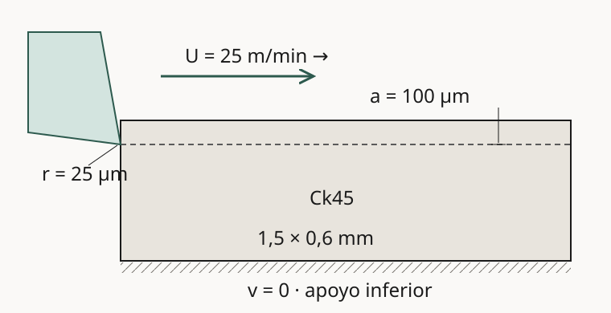
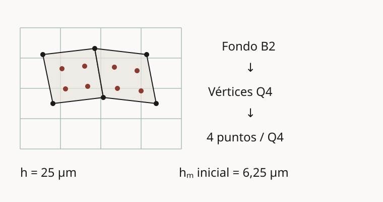

# Corte ortogonal de metales mediante MPM

**Del avance de la herramienta al flujo plástico y al calentamiento de la pieza.**
Metal_cutting desarrolla un modelo de corte ortogonal para estudiar cómo el
contacto, la deformación y la temperatura intervienen en la formación de viruta.
El objetivo es relacionar esa evolución con las fuerzas de corte y construir una
comparación cuantitativa con experimentos.

[Repositorio](https://github.com/MC-Andes/Metal_cutting){ .md-button .md-button--primary }
[Ejecutar el MPM](https://github.com/MC-Andes/Metal_cutting/blob/main/RUN_MPM.md){ .md-button }

!!! info "En desarrollo y verificación numérica"
    La ruta MPM pública no acredita todavía el recorrido objetivo de 500 µm,
    una viruta desarrollada ni validación experimental. Las imágenes de esta
    página muestran un **prefijo diagnóstico no aceptado**. Una ejecución que
    termina sin error de software no equivale a una solución física verificada.

## El problema: cortar un sólido que cambia de forma

Durante el mecanizado, el filo comprime y desplaza el material situado delante
de él. La deformación plástica concentra trabajo mecánico en una región pequeña;
el deslizamiento sobre la herramienta añade fricción y calor. La temperatura
modifica la resistencia del metal y altera, a su vez, la respuesta mecánica.
Predecir únicamente la trayectoria de la herramienta no permite determinar las
fuerzas ni la geometría final de la viruta.

El corte ortogonal aproxima una franja cuyo desplazamiento está contenido en un
plano y es independiente de la dirección transversal. Esta idealización permite
estudiar el acoplamiento antes de abordar geometrías tridimensionales. El esquema
siguiente sitúa el filo, la pieza y el apoyo del caso de desarrollo.

<figure markdown="span">
{ loading=lazy width=760 height=390 }
<figcaption>Configuración inicial conceptual, sin deformación calculada y no a escala. El borde inferior permanece fijo; el resto del contorno está libre de tracciones salvo donde se activa el contacto. La tabla precisa los datos geométricos.</figcaption>
</figure>

| Magnitud | Caso de desarrollo |
| --- | --- |
| Pieza y ancho representado | 1,5 × 0,6 mm; ancho de 1 mm |
| Espesor sin cortar y radio de filo | 100 µm y 25 µm |
| Ángulos de ataque e incidencia | 10° y 7° |
| Velocidad prescrita | 25 m/min = 0,4167 m/s |
| Recorrido y duración objetivo | 500 µm en 1,2 ms; **objetivo, no resultado alcanzado** |
| Fricción y partición térmica | μ = 0,35; 90 % del calor de fricción hacia la pieza |

Estos valores proceden del [caso Ck45 publicado](https://github.com/MC-Andes/Metal_cutting/blob/6026aef4401f70af853ecb0b20a8e1ec3dfb852b/cases/cutting2d/mpm_ck45_current.json).
Son elecciones del caso de desarrollo y no identifican por sí solas una réplica
experimental. La herramienta es rígida, su velocidad se prescribe desde el
inicio y el material parte del reposo a 293,15 K. Se adopta deformación plana con
estado constitutivo tridimensional, sin intercambio térmico con el ambiente ni
conducción hacia la herramienta; el contacto incorpora el calor de fricción. Se omiten dilatación térmica, desgaste y cambio de fase.

## De la literatura al experimento de referencia

La tarjeta material emplea parámetros de Johnson–Cook del AISI 1045 normalizado
publicados por **Jaspers (1999)** como aproximación a Ck45. La coincidencia de la
designación del acero no garantiza que sus propiedades correspondan al lote de
un ensayo; esta elección todavía requiere calibración y análisis de sensibilidad.

**Klippel et al. (2024)** proporcionan un banco experimental de corte seco de Ck45
y Ti6Al4V, con fuerzas, geometría del filo e imágenes y espesores de viruta. Es una
referencia para la futura comparación de fuerza de corte, fuerza de empuje y
espesor de viruta bajo condiciones equivalentes. La publicación del conjunto de
datos no constituye una validación del modelo de MC-Andes. Actualmente no se
presenta aquí una curva simulación–experimento ni un error de predicción.

Los trabajos de **Nairn**, **Cortis et al.** y **Coombs et al.** aportan antecedentes
sobre corte mediante MPM, imposición de condiciones esenciales y MPM implícito en
deformación finita, respectivamente. La discretización desarrollada en este
proyecto se describe a continuación; no se identifica automáticamente con las
implementaciones de esos artículos. Las referencias completas cierran la página.

## Un modelo termomecánico acoplado

Sea **X** la posición material de referencia y **x** = **χ**(**X**, t) su posición
actual. La velocidad **v** es la derivada temporal del movimiento y
**F** = ∂**χ**/∂**X** su gradiente de deformación. La densidad ρ, el tensor de
tensión de Cauchy **σ** y la temperatura T satisfacen los balances siguientes.
El punto superpuesto indica derivada siguiendo al material.

<div class="cutting-equation" role="math" aria-label="Conservación de masa: rho por determinante de F igual a rho inicial">
ρ det <b>F</b> = ρ<sub>0</sub>
</div>

La masa de cada porción material permanece constante: cuando cambia su volumen,
cambia su densidad. El balance de cantidad de movimiento, sin fuerzas de volumen,
relaciona la aceleración con la distribución de tensiones:

<div class="cutting-equation" role="math" aria-label="Balance de cantidad de movimiento: rho por aceleración igual a divergencia de sigma">
ρ <b>v̇</b> = ∇ · <b>σ</b>
</div>

La evolución térmica combina conducción y conversión del trabajo plástico en
calor. Con calor específico c<sub>p</sub>, conductividad k y potencia plástica por
unidad de volumen actual D<sub>p</sub>, se escribe:

<div class="cutting-equation" role="math" aria-label="Balance térmico: rho por calor específico por derivada material de temperatura igual a divergencia de k gradiente T más beta por potencia plástica">
ρ c<sub>p</sub> Ṫ = ∇ · (k ∇T) + β D<sub>p</sub>
</div>

Aquí β = 0,9 es la fracción de trabajo plástico convertida en calor. La fricción
aporta además una carga térmica en la superficie de contacto. Se impone
impenetrabilidad y una ley de Coulomb: la tracción tangencial está limitada por
μ veces la presión normal y se opone al deslizamiento.

La respuesta material separa **F** = **F**<sub>e</sub> **F**<sub>p</sub>, con
plasticidad isócora, elasticidad logarítmica de Hencky y criterio J2. La tensión
de fluencia Y depende de la deformación plástica equivalente acumulada α, de su
velocidad α̇ y de la temperatura normalizada θ:

<div class="cutting-equation" role="math" aria-label="Ley de Johnson Cook: A más B alfa a la n, por uno más C logaritmo del máximo de uno y la velocidad plástica normalizada, por uno menos theta a la m">
Y = (A + Bα<sup>n</sup>) [1 + C ln max(1, α̇/α̇<sub>0</sub>)] (1 − θ<sup>m</sup>)
</div>

A y B fijan la escala de resistencia, n el endurecimiento, C la sensibilidad a la
velocidad y m el ablandamiento térmico. θ normaliza T entre la temperatura de
referencia y la de fusión y se limita al intervalo [0, 1]. El retorno constitutivo
actualiza conjuntamente la plasticidad y su calentamiento. Así, las tensiones
utilizadas en el equilibrio dependen de la historia térmica y mecánica.

## Dos discretizaciones, una geometría material

El método de puntos materiales (MPM) combina el seguimiento del sólido con una
malla de fondo para resolver su movimiento. Aquí la pieza se divide en
cuadriláteros Q4 con vértices compartidos y cuatro puntos de integración por
dominio. Estos puntos conservan las variables plásticas y la temperatura. Una
base B-spline cuadrática, denominada B2, parametriza las velocidades en la malla
cartesiana de fondo; la transferencia pasa primero por los vértices Q4.

<figure markdown="span">
{ loading=lazy width=760 height=400 }
<figcaption>Esquema conceptual de la transferencia compuesta; los tamaños indicados son los iniciales del caso. Los puntos de integración y los grados de libertad de la malla de fondo tienen funciones diferentes. No es una imagen de una malla convergida.</figcaption>
</figure>

La interpolación material determina geometría, gradiente de deformación, volumen
y fuerzas internas. La formulación de potencia virtual produce una masa
consistente y transferencias adjuntas de fuerzas y velocidades. Las condiciones
esenciales restringen el espacio admisible en el apoyo. La conducción utiliza
Galerkin discontinuo con penalización interior simétrica y corrección conservativa
de flujos; sus subincrementos se integran mediante SSPRK2.

El lanzador público usa un **arranque explícito hasta 5 ns y después Euler
implícito adaptativo**. La receta de referencia fija h = 25 µm, tamaño material
inicial de 6,25 µm, incremento inicial de 25 ps y máximo mecánico de 100 ns. El
incremento aceptado puede ser mucho menor. La integración implícita no elimina
las exigencias de precisión temporal, contacto, actualización constitutiva ni la
restricción de los subincrementos térmicos.

!!! note "Qué implementación describe esta página"
    La ruta actual usa código propio Python/C++ y **no requiere Kratos**.
    El repositorio también conserva una preparación histórica PFEM/Kratos,
    documentada en su [informe inicial](https://github.com/MC-Andes/Metal_cutting/blob/main/reports/informe_tecnico_es.md).
    Algunas etiquetas heredadas del JSON no describen el algoritmo efectivo:
    la ejecución actual se define por el lanzador y los módulos MPM enlazados.

## Código, dependencias y flujo de ejecución

| Componente | Responsabilidad |
| --- | --- |
| Python 3.12 y código del proyecto | Configuración, transferencias, contacto, integración, auditoría y reinicio |
| C++17 y núcleos del proyecto | Operaciones constitutivas y algebraicas compiladas |
| NumPy y SciPy | Álgebra y tratamiento de arreglos |
| pybind11 y Eigen 3.4.0 | Interfaz Python/C++ y álgebra lineal nativa; herramientas externas |
| Posprocesamiento | Estados NPZ, registros JSON/JSONL y visualizaciones derivadas |

El [lanzador de ejecución](https://github.com/MC-Andes/Metal_cutting/blob/main/reports/corte_desarrollado_numerico_20260910/formulacion/mpm_runtime_frozen_v4/launch.py)
prepara un entorno con fuentes, caso y huellas de integridad. La secuencia es
**preparar → comprobar → ejecutar → revisar balances → continuar desde un
checkpoint**, siempre con destinos nuevos. El código de
[transferencia y resolución MPM](https://github.com/MC-Andes/Metal_cutting/tree/main/verification/cutting2d/cpdi_mpm_candidate)
y la [actualización constitutiva](https://github.com/MC-Andes/Metal_cutting/blob/main/verification/cutting2d/direct_q4_candidate/constitutive.py),
con su [núcleo C++](https://github.com/MC-Andes/Metal_cutting/blob/main/verification/cutting2d/direct_q4_candidate/native/finite_jc_batch.cpp),
permiten revisar la formulación efectiva. Los nombres históricos de carpetas no
implican que se implemente literalmente un método CPDI estándar.

### Reproducir primero un arranque mínimo

La [guía de ejecución](https://github.com/MC-Andes/Metal_cutting/blob/main/RUN_MPM.md)
contiene la instalación, la receta de producción y el reinicio. Para comprobar
una instalación nueva sin lanzar una campaña de horas, puede ejecutarse el
siguiente arranque. Requiere Python 3.12, compilador C++17 y cabeceras de Python.
La revisión de esta ficha lo ejecutó en macOS ARM64; otros sistemas siguen
pendientes de comprobación.

```sh
git clone https://github.com/MC-Andes/Metal_cutting.git
cd Metal_cutting
git checkout 6026aef4401f70af853ecb0b20a8e1ec3dfb852b
python3.12 -m venv .venv
.venv/bin/python -m pip install -r requirements-mpm.txt

MPM_LAUNCH=reports/corte_desarrollado_numerico_20260910/formulacion/mpm_runtime_frozen_v4/launch.py
.venv/bin/python -I "$MPM_LAUNCH" prepare runs/runtime_smoke \
  --backend certified_range_robust --case cases/cutting2d/mpm_ck45_current.json
.venv/bin/python -I "$MPM_LAUNCH" check runs/runtime_smoke \
  --grid-h 100e-6 --material-h 25e-6 --dt 100e-9 \
  --startup-dt 25e-12 --end 50e-12 --wall 30 --threads 1
.venv/bin/python -I "$MPM_LAUNCH" run runs/runtime_smoke \
  --destination runs/smoke --grid-h 100e-6 --material-h 25e-6 \
  --dt 100e-9 --startup-dt 25e-12 --end 50e-12 --wall 30 --threads 1
```

**Resultado observado:** dos incrementos hasta 50 ps, sin rechazo ni fallo de
ejecución. El estado final es `completed_unverified`, con `accepted=false`.
El residuo energético de esta ventana inicial es aproximadamente 49,99 % y aún
no hay plasticidad. Por tanto, es una prueba de instalación y recorrido del
programa, **no una verificación física del corte**. La malla gruesa de esta
receta tampoco representa la resolución del caso de desarrollo.

## Qué muestran los resultados disponibles

El siguiente prefijo histórico permite observar dónde comienzan a concentrarse
la plasticidad y el calentamiento alrededor del filo. Se publican 25 fotogramas
calculados entre 0 y 57,6 µs, correspondientes a 0–24 µm de avance. Su procedencia
se conserva en el [manifiesto del recurso](../assets/metal-cutting/provenance.json).
No se interpolaron estados ni se corrigió su geometría para la presentación.

<div class="cutting-media-grid">
<figure>
<video controls muted playsinline preload="metadata" poster="../../assets/metal-cutting/plasticity.png" aria-label="Evolución diagnóstica de la deformación plástica equivalente, de cero a 57,6 microsegundos">
<source src="../../assets/metal-cutting/plasticity.mp4" type="video/mp4">
<a href="../../assets/metal-cutting/plasticity.mp4">Descargar la animación de plasticidad</a>
</video>
<figcaption>Deformación plástica equivalente α, adimensional. Media aritmética de los cuatro puntos de integración por dominio; no representa el máximo puntual. Los ejes muestran posiciones en µm.</figcaption>
</figure>
<figure>
<video controls muted playsinline preload="metadata" poster="../../assets/metal-cutting/temperature.png" aria-label="Evolución diagnóstica de temperatura absoluta, de cero a 57,6 microsegundos">
<source src="../../assets/metal-cutting/temperature.mp4" type="video/mp4">
<a href="../../assets/metal-cutting/temperature.mp4">Descargar la animación de temperatura</a>
</video>
<figcaption>Temperatura absoluta T en K, promediada por dominio. La escala permanece fija durante toda la secuencia, al igual que en la animación de plasticidad.</figcaption>
</figure>
</div>

La deformación y el calentamiento se localizan cerca del contacto durante este
intervalo corto. Esta observación no acredita una viruta desarrollada, equilibrio
estacionario ni concordancia experimental. El prefijo conserva
**`accepted=false`**. Es evidencia histórica local incorporada como recurso
visual, no el resultado del arranque mínimo ni de una nueva ejecución del commit
público. Los estados NPZ completos todavía no se distribuyen con el portal;
las huellas del manifiesto permiten identificar los archivos, pero no sustituyen
un archivo de datos accesible para reproducir estos videos.

## Límites y siguiente paso científico

La conectividad Q4 fija conserva la continuidad geométrica, pero no crea nuevas
superficies de fractura. El modelo tampoco incorpora autocontacto ni una longitud
interna que regularice la localización por ablandamiento. Una forma parecida a
una viruta no demostraría por sí sola que se haya modelado su separación física.

El coste actual proviene tanto de los numerosos incrementos pequeños como de
las resoluciones de contacto, constitutivas y de equilibrio. Antes de calibrar,
se deben completar controles de balance y sensibilidad espacial/temporal,
obtener un intervalo físico suficiente y comparar magnitudes bajo condiciones
experimentales equivalentes. Una extensión 3D requiere además revisar las
hipótesis de contorno y los mecanismos de separación.

| Pendiente | Evidencia necesaria para cerrarlo |
| --- | --- |
| Corte desarrollado | Recorrido objetivo, evolución material y balances aceptados |
| Validación | Ensayo identificado, datos originales y comparación de fuerzas y viruta |
| Reproducibilidad del video | Archivo público de los estados NPZ y entorno correspondiente |
| Portabilidad | Ejecución de los núcleos compilados en otros sistemas |
| Gobernanza | Responsable científico, colaboradores, forma de citación y licencia propia |

El proyecto está alojado en **MC-Andes**. El commit público inspeccionado acredita
una contribución de **Nicolas Andres Useche Castillo**; no establece una lista
completa de autores ni una dirección científica. El repositorio no declara
actualmente una licencia propia. Las dependencias conservan sus licencias;
la disponibilidad pública del código no implica una autorización de uso que
sustituya esa declaración pendiente.

## Referencias y función de cada fuente

1. **Jaspers, S. P. F. C. (1999).** *Metal cutting mechanics and material behaviour*.
   Tesis doctoral, Eindhoven University of Technology.
   [DOI: 10.6100/IR520863](https://doi.org/10.6100/IR520863).
   Fuente de parámetros constitutivos; no validación del solver.
2. **Klippel, H., Süssmaier, S., Zhang, N., Kuffa, M. y Wegener, K. (2024).**
   *Large-scale investigation of dry orthogonal cutting experiments Ti6Al4V and Ck45*.
   The International Journal of Advanced Manufacturing Technology, 135, 2871–2908.
   [DOI: 10.1007/s00170-024-14597-2](https://doi.org/10.1007/s00170-024-14597-2).
   Banco experimental y propiedades típicas; comparación cuantitativa pendiente.
3. **Nairn, J. A. (2015).** *Numerical simulation of orthogonal cutting using the
   material point method*. Engineering Fracture Mechanics, 149, 262–275.
   [Manuscrito del autor](https://www.cof.orst.edu/cof/wse/faculty/Nairn/papers/MPMCutting.pdf).
   Antecedente de aplicación de MPM al corte.
4. **Cortis, M. et al. (2018).** *Imposition of essential boundary conditions in
   the material point method*. International Journal for Numerical Methods in
   Engineering, 113, 130–152.
   [DOI: 10.1002/nme.5606](https://doi.org/10.1002/nme.5606).
   Antecedente para el tratamiento de condiciones esenciales.
5. **Coombs, W. M. et al. (2020).** *On Lagrangian mechanics and the implicit
   material point method for large deformation elasto-plasticity*.
   Computer Methods in Applied Mechanics and Engineering, 358, 112622.
   [DOI: 10.1016/j.cma.2019.112622](https://doi.org/10.1016/j.cma.2019.112622).
   Antecedente de formulación lagrangiana e integración implícita.

*Revisión del contenido: 17 de octubre de 2026. Código examinado:
[6026aef](https://github.com/MC-Andes/Metal_cutting/commit/6026aef4401f70af853ecb0b20a8e1ec3dfb852b).
Los esquemas son originales y conceptuales; las animaciones proceden del
prefijo identificado en su manifiesto. No se reproducen figuras de terceros.*

[Volver al catálogo](../projects.md){ .md-button }
